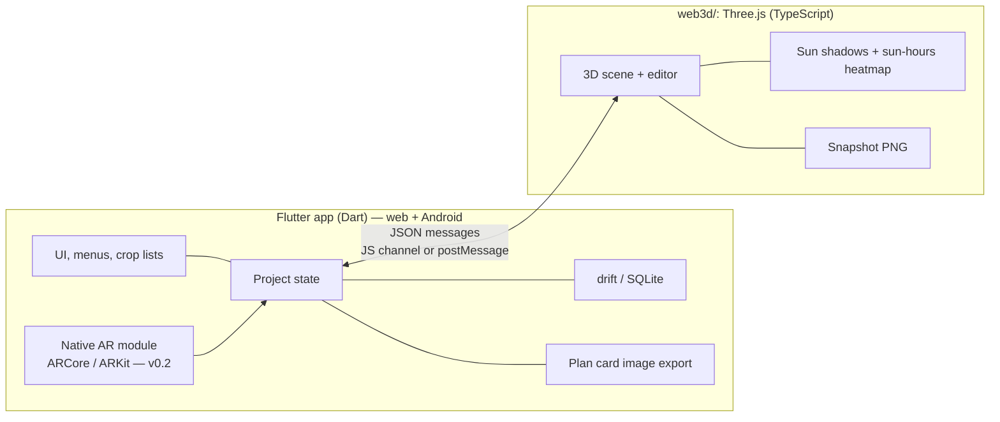

# App Goal — Small-Space Urban Farming Planner

Status: **agreed** (from issue GAMM-5 "App Goal Discussion", 2026-10-18).

## Goal

> A mobile-friendly app where ordinary people model their own small space in 3D (balcony, terrace, small yard, windowsill, wall) and get a planting plan that makes the most of it: what to grow, where to put it, and how to stack it vertically.

- **Audience:** ordinary people with little space who want to grow food. Worldwide eventually, **Indonesia first**.
- **Language:** Bahasa Indonesia first, English second. All strings go through i18n from day one.
- **Units/locale:** metric, Indonesian time zone by default, the user's location for sun calculations.
- **No cloud backend in v1.** Everything stays on the device.

## MVP features

1. **Model your space in 3D.** Enter the dimensions, mark walls, railings and obstacles, and set the facing direction and floor/height. On the web this is a manual form; in the app, AR measuring is added (v0.2).
2. **Sun map.** From the location, the facing direction and nearby walls, show the sun hours for each spot as a heatmap, with a time-of-day slider and real-time shadows.
3. **Plant suggestions.** A tropical/Indonesian crop database (cabai, tomat, kangkung, bayam, sawi, selada, terong, kemangi, serai, daun bawang, …) matched against each spot's sun hours, pot depth and climate. Each crop has its sun need, minimum pot depth and days to harvest.
4. **Layout planner.** Drag in pots, vertical racks, hanging planters and wall planters. Check fit and shading. Show the growing area gained (e.g. "2 m² floor → 5.4 m² growing area") and the estimated harvest.
5. **Save and share.** Auto-save on the device. Export images (see below).

### Out of scope for v1
Cloud sync/accounts, `.kebun` project files, `.glb` 3D export, PDF export, IoT sensors, marketplace.

## Tech stack

| Area | Choice |
|---|---|
| App shell & UI | **Flutter** (Dart), one codebase for **web + Android** (iOS later) |
| 3D | **Three.js** (TypeScript, Vite) in `web3d/`, bundled with the app so it works offline |
| 3D embedding | App: `flutter_inappwebview` WebView. Web: `<iframe>` through `HtmlElementView` |
| Flutter ↔ 3D bridge | Versioned JSON message protocol behind one Dart interface. Transport: JS channel (app) or `window.postMessage` (web) |
| Storage | **drift** (SQLite). On the web: SQLite WASM persisted in IndexedDB. Debounced auto-save |
| AR measuring (v0.2) | Own thin native module behind a platform channel: Kotlin + ARCore (Android), later Swift + ARKit (iOS). Returns corner points + compass heading. No third-party Flutter AR plugin |
| Image export | 3D snapshot from Three.js (base64 PNG) + "Kebunku" plan card composed in Flutter (`RepaintBoundary.toImage()`). App: `gal` + `share_plus`. Web: download + Web Share API |
| Web hosting | Firebase Hosting or Cloudflare Pages, deployed from CI. Installable PWA with offline cache |



### Responsibilities
- **Flutter:** all UI, project state (the single source of truth), storage, crop database and suggestion logic, plan card export, AR (app only).
- **Three.js:** rendering, the 3D editor interactions, sun position, shadows and the sun-hours heatmap, snapshots. It holds no persistent state of its own.

## Storage and export details
- One project = one row: name, location, facing direction, project data (JSON), thumbnail, `updated_at`. drift schema migrations from day one.
- Home screen: a project list with thumbnails.
- Android Auto Backup / iCloud backup cover app data for free.
- **Plan card ("Kebunku")** contains the 3D snapshot, the top-down plan with the sun heatmap, the plant list and positions, the growing-area summary, estimated harvest, shopping list, and the app logo + web link.
- Known limits: images cannot be re-opened for editing. Uninstalling without a backup loses data. On the web, Safari on iOS can evict storage after about 7 days without a visit unless the site is added to the Home Screen, so we prompt "Add to Home Screen" and encourage exporting the plan card.

## Web vs app

| Feature | Android app | Web (PWA) |
|---|---|---|
| Space input | AR measuring + manual | Manual form |
| Facing direction | Phone compass | Compass dial picker |
| Location | GPS | Browser location or city picker |
| Storage | drift / SQLite | drift / SQLite WASM in IndexedDB |
| Image export | Gallery + share sheet | Download + Web Share API |

## Release plan

1. **v0.1 — Web (PWA).** Sun map, plant suggestions, layout planner, image export, manual space input. No AR. About 3–4 weeks for one engineer.
2. **v0.2 — Android (Play Store).** Same app + native AR measuring + native sharing.
3. **Later — iOS.** ARKit, then RoomPlan on LiDAR iPhones.

## Work breakdown

| # | Work item | Release |
|---|---|---|
| 1 | Spike: Three.js performance in a WebView on low-end Android + in Flutter Web, bridge prototype | v0.1 |
| 2 | Project setup: Flutter app (web + Android targets) + `web3d/` (Vite, TS), CI, ID/EN i18n, web hosting + PWA | v0.1 |
| 3 | Flutter ↔ Three.js bridge: message protocol, schema, two transports | v0.1 |
| 4 | 3D scene and editor (2D/3D view, drag pots and racks, manual space input) | v0.1 |
| 5 | Sun engine: real-time shadows and sun-hours heatmap | v0.1 |
| 6 | Indonesian crop database and suggestion logic | v0.1 |
| 7 | Local storage (drift, auto-save, project list) and image export (snapshot + plan card) | v0.1 |
| 8 | Browser testing (Chrome Android, Safari iOS, desktop) and web launch | v0.1 |
| 9 | Native AR measuring module (ARCore) + manual fallback | v0.2 |
| 10 | Real-device testing and Play Store internal testing | v0.2 |

## Proposed repository layout

```
/
├─ app/          Flutter app (web + Android)
├─ web3d/        Three.js scene (TypeScript, Vite); build output is bundled into app/
├─ docs/         Product and technical docs (this file)
└─ .github/      CI workflows
```
